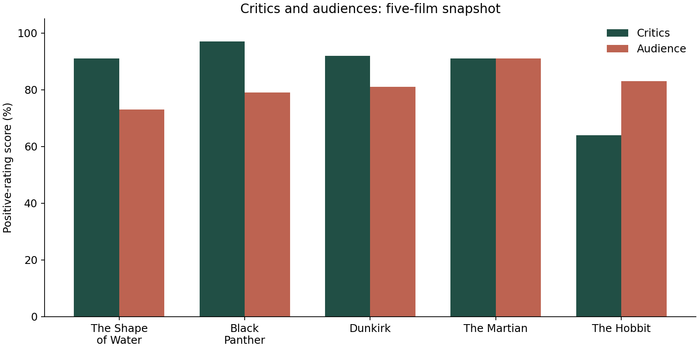
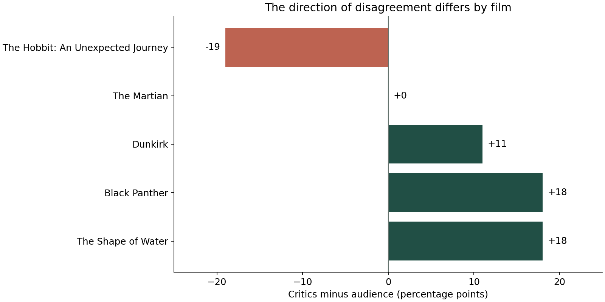
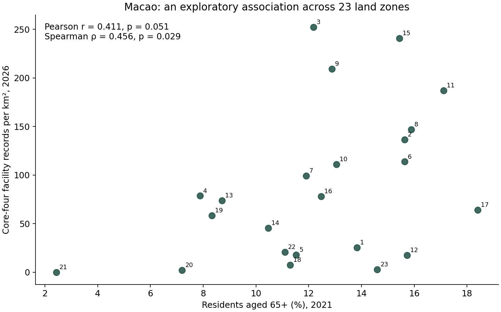
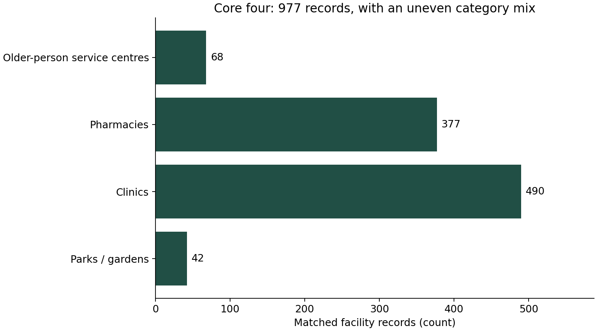

# Data science projects — Zuo Ziyi

Two reproducible project showcases for CISC7204: the preserved movie-score exercise and the ongoing Macao team study. Original coursework notebook and image remain in place.

## Run from a fresh checkout
```sh
git clone https://github.com/ZuoZiyi-mc642637/data-science-project.git
cd data-science-project
python -m venv .venv
# Windows: .venv\Scripts\activate
# macOS/Linux: source .venv/bin/activate
python -m pip install -r requirements.txt
python analysis_movie.py
python macao/analysis.py
python -m jupyterlab
```
Open `MC642637_Activity6.02.ipynb` in JupyterLab for the original exercise, with this repository as the working directory. The two scripts use paths relative to their own files and regenerate the portfolio's charts without notebook execution. Tested reproduction and software versions are recorded in `VERIFICATION.txt`.

## Movie scores: do critics and audiences agree?
**Status:** completed course exercise. **Question:** How do the supplied critic and audience scores differ across five films?

The course-supplied `movie_scores.csv` has five rows: title, Tomatometer score and audience score. The metrics originate from [Rotten Tomatoes](https://www.rottentomatoes.com/); the original course extract supplies no per-film retrieval date or explicit redistribution licence. Scores are a historical classroom snapshot, not current ratings. Educational purpose alone does not establish permission; source provenance and reuse terms need confirmation before wider reuse. No new scraped data or personal information has been added.

Methods: pandas for reading and calculating score gaps; Matplotlib for a grouped comparison and a signed gap chart. The original Notebook also uses NumPy.

| Film | Critics | Audience | Critics − audience |
|---|---:|---:|---:|
| The Shape of Water |91|73|18|
| Black Panther |97|79|18|
| Dunkirk |92|81|11|
| The Martian |91|91|0|
| The Hobbit: An Unexpected Journey |64|83|−19|

The largest absolute gap in this sample is19 percentage points for The Hobbit, favouring audiences. The Martian has equal scores. These findings describe five selected films only; this is not evidence that disagreement is common across all films. Scores have different underlying reviewer populations and are not interchangeable measures of film quality.




Visual checks: the comparison uses a zero-based0–100 percentage scale; gap bars are centred at zero and labelled in percentage points. Consistent colours identify the two groups. Two views show magnitude and direction without implying generality beyond this sample.

## Featured ongoing team project
[Macao facilities and older residents: methods, sources, team attribution, results and limitations](macao/README.md)




## Feedback and responsible sharing
See [review evidence](REVIEW.md). Genuine classmate review and a resulting commit are still required; automated checks and AI suggestions are not substituted for peer feedback. Original data ownership is retained; no blanket licence is applied to the coursework or third-party datasets.

